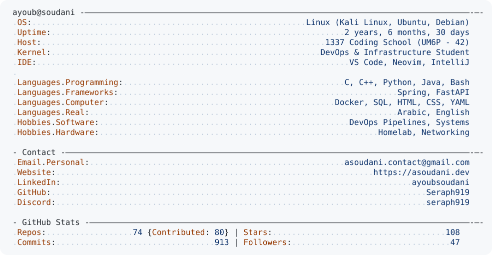

<a href="https://github.com/Seraph919/Seraph919">
  <picture>
    <source media="(prefers-color-scheme: dark)" srcset="https://raw.githubusercontent.com/Seraph919/Seraph919/assets/dark_mode.svg">
    
  </picture>
</a>

## Project Showcase

### Software Engineering

<table>
<tr>
<td width="50%" valign="top">

### [Store Studio](https://github.com/Seraph919/Store-Studio)
Self-hosted, open-source e-commerce platform with customizable storefronts, inventory and order management.

`Java` `Spring Boot` `Angular` `Docker`

[Source Code](https://github.com/Seraph919/Store-Studio) · [Live Demo](https://storestudio.asoudani.dev)

</td>
<td width="50%" valign="top">

### [Guild Chat](https://github.com/Seraph919/guild-chat.tech)
Real-time communication platform built on a distributed microservices architecture by a team of five developers.

`Microservices` `Docker` `Redis` `PostgreSQL`

[Source Code](https://github.com/Seraph919/guild-chat.tech) · [Website](https://guild-chat.tech)

</td>
</tr>
<tr>
<td valign="top">

### [Store Studio MCP](https://github.com/Seraph919/Store-Studio-MCP-Server)
MCP server connecting AI agents to e-commerce orders, inventory, analytics and store settings.

`Python` `MCP` `REST API`

[Source Code](https://github.com/Seraph919/Store-Studio-MCP-Server)

</td>
<td valign="top">

### [DailyCode](https://github.com/Seraph919/DailyCode)
Discord-based coding challenge platform with automated LeetCode assignments and progress tracking.

`Discord API` `Automation` `LeetCode`

[Source Code](https://github.com/Seraph919/DailyCode) · [Website](https://dailycode.asoudani.dev)

</td>
</tr>
</table>

### Systems Programming

<table>
<tr>
<td width="50%" valign="top">

### [Webserv](https://github.com/Seraph919/Webserv)
HTTP server built from scratch in collaboration with two other developers.

`C++` `HTTP` `Sockets` `Networking`

</td>
<td width="50%" valign="top">

### [Minishell](https://github.com/Seraph919/BashLikeUnixShell)
Bash-inspired Unix shell supporting command execution, pipes, redirections and environment variables.

`C` `POSIX` `Process Management`

</td>
</tr>
<tr>
<td valign="top">

### [Custom Wolfenstein](https://github.com/Seraph919/CustomWolfenstein)
Raycasting-based game engine inspired by Wolfenstein 3D.

`C` `Graphics` `Raycasting`

</td>
<td valign="top">

### [Dining Philosophers](https://github.com/Seraph919/The_Dining_Philosophers_Problem)
Concurrent simulation exploring thread synchronization, shared resources and deadlock prevention.

`C` `POSIX Threads` `Mutexes`

</td>
</tr>
<tr>
<td valign="top">

### [Minitalk](https://github.com/Seraph919/Minitalk)
Client-server communication implemented using Unix signals.

`C` `IPC` `Unix Signals`

</td>
<td valign="top">

### [Libft](https://github.com/Seraph919/libft)
Custom implementation of standard C library functions and reusable data structures.

`C` `Memory Management`

</td>
</tr>
<tr>
<td valign="top">

### [ft_printf](https://github.com/Seraph919/ft_printf)
Custom implementation of the standard printf function.

`C` `Variadic Functions`

</td>
<td valign="top">

### [CPP Modules](https://github.com/Seraph919/CPP-Modules)
Collection of C++ projects covering object-oriented programming, templates, containers and algorithms.

`C++` `OOP` `STL`

</td>
</tr>
</table>

### DevOps & Infrastructure

<table>
<tr>
<td width="50%" valign="top">

### [Inception](https://github.com/Seraph919/inception)
Multi-container infrastructure with isolated services, persistent storage and secure networking.

`Docker` `Nginx` `MariaDB` `Linux`

</td>
<td width="50%" valign="top">

### [Docker Exporter](https://github.com/Seraph919/docker-exporter)
Lightweight Prometheus exporter for host, container, PostgreSQL and Nginx metrics.

`Prometheus` `Docker` `Observability`

</td>
</tr>
<tr>
<td valign="top">

### [WARP Bar](https://github.com/Seraph919/Warp-Bar-for-Wayland)
Cloudflare WARP status bar integration for Waybar and Omarchy desktop environments.

`Linux` `Wayland` `Cloudflare`

</td>
<td valign="top">

### [Arch Responsive Tester](https://github.com/Seraph919/arch-responsive-tester)
Desktop application for testing websites across multiple device viewports simultaneously.

`Electron` `Arch Linux` `Chromium`

</td>
</tr>
<tr>
<td valign="top">

### [GSpace](https://github.com/Seraph919/gspace-releases)
Portable application and storage management tool for 1337/42 students working with limited home directory storage.

`Linux` `Python` `Textual` `Node.js`

</td>
<td valign="top">

### [Tailwind Docker Starter](https://github.com/Seraph919/Tailwind-CSS-Docker-Starter)
Containerized starter environment for Tailwind CSS development.

`Docker` `Tailwind CSS`

</td>
</tr>
</table>

---

  <a href="https://github.com/Seraph919?tab=repositories">All Repositories</a>
  ·
  <a href="https://asoudani.dev">Portfolio</a>

